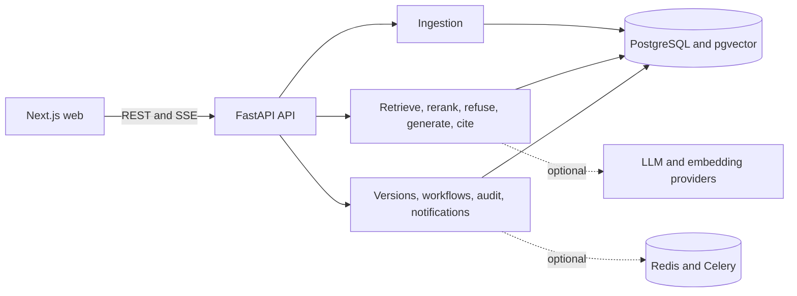

# GroundTruth

[](https://github.com/FishRaposo/groundtruth/actions/workflows/ci.yml)
[](apps/api/pyproject.toml)

**Ask an operational question. Inspect the evidence before trusting the answer.**

GroundTruth combines scoped retrieval, immutable citations, document versions and
human review in a FastAPI/Next.js application. The portable connected profile uses
real SQLite persistence, pinned local CPU semantic embeddings and clearly labeled
source-extractive answers. A separate visual sample tour runs without a backend.
PostgreSQL/pgvector and Redis/Celery code is included; live infrastructure
verification remains deferred while the owner continues without WSL.

[Visual tour](#portfolio-demo) · [Actual workflow](docs/portfolio-connected.md) · [Verification](docs/portfolio-verification.md) · [Case study](docs/portfolio-case-study.md) · [Setup](SETUP.md) · [Architecture](docs/ARCHITECTURE.md)

## Portfolio demo

Choose **Start guided demo** or explore freely. Persistent **Interactive sample
data** labeling distinguishes the preview from actual execution. One scenario
state drives Chat, Documents, Workflows and Admin, with complete reset.

```bash
cd apps/web
npm ci
npm run demo:ui
```

Open http://localhost:3505.

**Click path:**

1. Ask about staging rollback; open the highlighted current citation.
2. Compare an outdated runbook with the current version.
3. Inspect an unsupported-question refusal and a curated procedural conflict.
4. Follow a quarantined-file recovery, then inspect consistent review/audit views.
5. Open the actual workflow and engineering evidence.

The preview makes no API/provider/font request. Sample file selection does not
transmit file contents. Keyboard-operable source details return focus to the
citation; reduced motion and mobile/tablet layouts are supported. See the
[walkthrough](docs/portfolio-walkthrough.md).

Set `NEXT_PUBLIC_DEMO_MODE=true` in any Next.js build or dev command to enable
forced demo mode without the `demo:ui` script.

## Offline demo

The fastest proof path needs no credentials, database, Redis, model download, or
sibling repository:

```bash
python -m pip install -e "apps/api[dev]"
make demo
```

`make demo` runs the deterministic command-line grounded-answer and refusal demo.
It does not start Docker or open the web interface.

## Actual connected quickstart

```bash
python -m pip install -e "apps/api[dev,embeddings]"
python -m app.model_setup --directory .tmp/models/minilm
python scripts/portfolio_local.py migrate
python scripts/portfolio_local.py serve
```

- API: http://127.0.0.1:8400
- OpenAPI: http://127.0.0.1:8400/docs
- Production frontend: http://127.0.0.1:3505

Seed in a separate terminal with `python scripts/portfolio_local.py seed`, then
enter the generated disposable API key through **Connection**. The
[complete setup](docs/portfolio-connected.md) includes isolated environments,
CPU-only dependency installation, frontend build/start, private manifest handling
and explicit deterministic mode. Connected failures remain errors; switching to
sample mode is always explicit. Historical library defaults preserve the original
offline golden fixture and are not the authenticated application profile.

## Measured limits

The frozen corpus has 12 synthetic runbooks and 100 agent-authored cases; labels
have no human/model-quality validation. After development-only tuning, the first
held-out measurement passed 37/80 contracts per method: expected sources were
retrieved, but conservative support checks refused42 answerable cases and missed
one refusal. Zero unauthorized-source exposures or execution errors were observed.
The first result is preserved; subsequent repairs are exposed regressions, not
fresh held-out validation. Literal coverage is not entailment. See
[the case study](docs/portfolio-case-study.md) before making quality claims.

Live PostgreSQL/Redis, large indexed performance, hosted CI, provider quality and
hosted multi-user authentication remain unverified. No production-capacity or
universal contradiction-detection claim is made.

## What it does

1. **Ingests** TXT, PDF, Markdown, HTML, DOCX, CSV, and TSV by default. XLSX/PPTX,
   OCR, and model-backed embeddings/reranking are explicit extras.
2. **Normalizes and deduplicates** documents and chunks before embedding, retaining
   failed source files with quarantine metadata for reindexing.
3. **Retrieves** with vector and keyword search, reciprocal-rank fusion, and
   deterministic reranking fallbacks.
4. **Answers or refuses** using confidence and safety gates, with citations and a
   retrieval trace in normal and SSE flows.
5. **Tracks operations** with request/workspace context, structured audit events,
   cost attribution, API-key-aware rate limits, document version history, workflow
   status events, and a notification outbox.
6. **Supports local evaluation** through a dependency-free fixture adapter and a
   deterministic portfolio evidence bundle.

## Architecture



The API owns a narrow compatibility subset vendored at
`apps/api/app/internal/vendor_core/`. It is pinned to
`FishRaposo/operator-shared-core` v1.3.0 at commit
`dbf276a7708da65b55e1f10b35af634b300d1f07`, internally namespaced, MIT-licensed,
and shipped in the wheel. No external `shared_core` install, Git URL, or sibling
checkout is required. See [migration provenance](docs/migrations/2026-08-15-operator-shared-core-v1.3.0-vendoring.md).

## Verification

```bash
# Canonical installs
python -m pip install -e "apps/api[dev]"
cd apps/web && npm ci && cd ../..

# Complete local gate; Playwright Chromium must already be installed
make check

# Install the browser once when needed
cd apps/web && npx playwright install chromium
```

The gate covers API pytest, Ruff lint and format checks, Pyright, the forbidden
external-dependency scan, wheel build/content/isolated-import verification,
deterministic portfolio evidence, frontend Vitest, ESLint, production build, and
desktop plus Pixel 5 Chromium Playwright smoke tests. The CI `workflow_dispatch`
`integration` input installs PostgreSQL and Redis extras before rerunning the
SQLite/offline integration-shaped contracts; it does not claim live-service coverage.

The default gate (`make test` / CI) runs **284** API unit tests (integration-shaped
tests under `apps/api/tests/integration` are excluded). **`291`** API tests pass when
that integration folder is included (`make test-all` or
`python -m pytest apps/api/tests` from the repo root). The final local pass also
recorded **49 passing frontend Vitest tests across 12 files**, Ruff check/format,
repository-wide Pyright with zero errors,
a production Next.js build, and **8/8** desktop plus Pixel 5 Chromium smoke tests.
The evidence bundle reproduced byte-for-byte twice with hash
`daaa900b228aa7820ead848bdbf51ae3a6b723b514c24588f25f1f554741e334`.
Live PostgreSQL/Redis integration and Docker runtime execution were not available on
this host and are not implied pass claims.

## Security and deployment boundaries

- API authentication and rate limiting are configurable; rate buckets are isolated
  by workspace and hashed API-key identity.
- Uploaded filenames are not trusted for storage paths.
- SMTP, webhooks, OCR, Office parsing, local model inference, PostgreSQL, Redis, and
  Docker are opt-in integrations.
- SAML/SSO, hosted/team workflows, hosted notification services, mandatory
  infrastructure, cloud object storage, and hosted scheduling are deliberately
  deferred. See [Security](docs/SECURITY.md) and [Roadmap](ROADMAP.md).

## License and provenance

GroundTruth is MIT licensed. Third-party provenance and the vendored upstream license
are recorded in [THIRD_PARTY_NOTICES.md](THIRD_PARTY_NOTICES.md).
