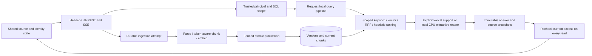
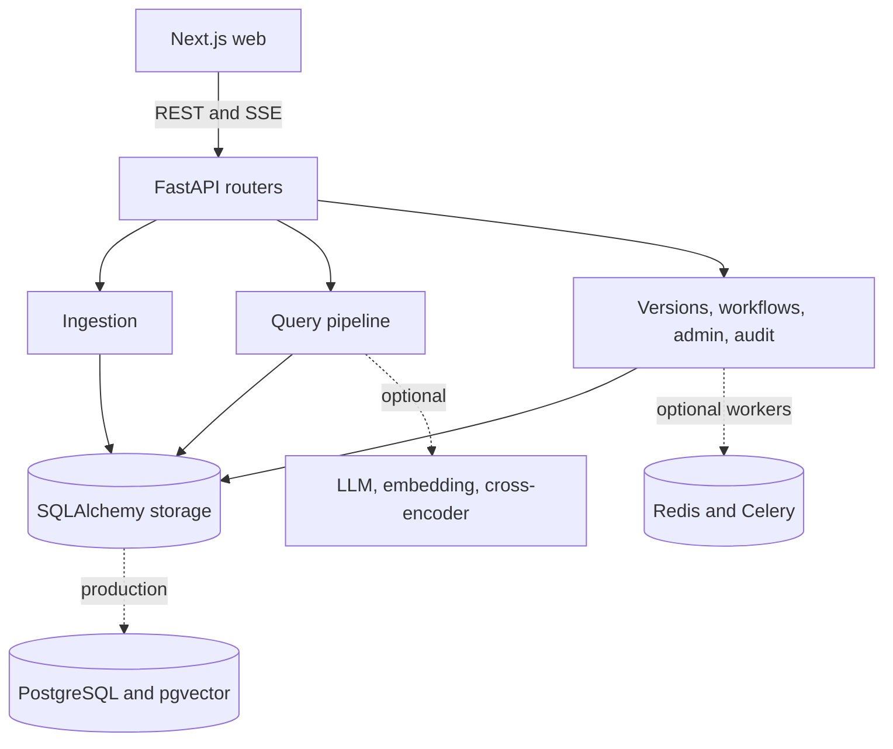
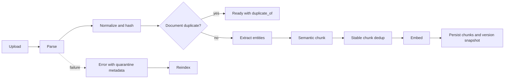

# Architecture

## Connected profile — Project05

The current portable path is SQLite/inline ingestion, pinned CPU semantic
embeddings and source-extractive generation. The
[actual workflow](portfolio-connected.md) specifies executable setup and modes;
[verification](portfolio-verification.md) distinguishes observed local results
from deferred PostgreSQL/Redis and hosted execution.

`access_control/scope.py` owns authorization predicates before candidate limits.
The injected session, principal, document/collection filters and published
versions travel together; normal and streaming routes share `connected_query`.
Request-local results carry counts, ranks, timings and embedding provenance.
Library compatibility counters remain outside the connected API contract.

SQLite performs scoped exact ranking. The PostgreSQL branch uses filtered SQL
vector/full-text candidates, HNSW/GIN representations and scoped exact fallback;
its actual indexed behavior remains unverified locally. Embeddings carry mode,
model, revision, dimension and chunking version. Unknown representations require
explicit reindexing. Runtime loads local assets only after integrity checks.

Ingestion uses one canonical service for inline and Celery dispatch. Durable jobs
claim a single active attempt; tokens, renewable leases and publication fencing
separate healthy work from abandoned claims. A replacement publishes only after
parse/chunk/embed success, retaining the old version during failure. Restoration
creates a new content revision with regenerated compatible embeddings; reindex
preserves content revision identity. Generated storage names stay under the
configured root. Additive migrations retain historical rows without inventing
ownership or source/model evidence.

Stored citations bind document/version/hash and exact passage. Current access is
rechecked before returning saved answers, sources and conversation context.
Conversation messages never enter numbered source authority. Cancellation/error
retains an interrupted/error record rather than a completed answer. Normal and
SSE responses preserve legacy keys and the data.type event vocabulary.

The frontend uses one provider for sample/source/identity/conversation state.
Obsolete requests and streams are aborted; incompatible private views clear on
identity changes. Saved-query links load real history. Sample scenarios reset
together and never replace connected failures. Public evidence files are generated
copies of canonical documentation, not independent claim sources.

Answer selection is explicit. The compatibility lexical path retains its literal
coverage contract. The optional reader path uses pinned local SQuAD2 QA weights,
direct tokenizer/model inference and a null-versus-span comparison; it copies a
source passage instead of generating prose. Model/tokenizer state is shared
behind a CPU inference lock, while context windows, offsets, logits and request
decisions remain local. Cancellation abandons the result, including when an
already-running CPU call finishes later. Missing/corrupt assets are errors.

The continued `reader-parts-v3` contract prepares bounded explicit question parts
and requires an accepted selection for every recognized part across authorized
chunks. A compact cover must fit the three-citation cap; curated conflicts are
checked before that cover can omit an opposing source. Per-part reasons, missing
coverage and exact spans remain inspectable. Recursive diagnostic sanitization
removes uncited raw candidate text. Named scope and bounded mismatch rejections
are not an entailment judge. Arbitrary unrecognized grammar retains the original
question. See the [development record](answer-coverage-development-v3.md) for
failed measurements and limits.

Citation selection ranks already accepted witnesses for each question part using
raw null margins, then minimizes citations without dropping the strongest
witnesses. Exact ties retain candidate order; missing legacy scores are unknown
and retain coverage compatibility. A required cover beyond three sources refuses
instead of silently substituting weaker evidence. This ranking is recorded
separately and does not certify factual support.

Connected SQLite reads drain before request cancellation is rethrown, allowing
interrupted-outcome cleanup to finish without an abandoned read cursor blocking
its commit. Stream lifecycle ownership closes an iterator even when a transport
send fails before iteration or leaves it paused at yield. Application completion
and later delivery failure remain distinct. Only database work is drained;
provider requests and CPU reader inference remain cancellable/abandonable.

An immutable catalog allows only the two approved extractive model revisions.
Explicit setup downloads assets; runtime checks manifest identity, contained
paths and file hashes before loading local safetensors without remote code. Extra
unverified root files are rejected so a preferred tokenizer file cannot silently
override the verified layout. The larger reader remains an explicit comparison,
with unchanged MiniLM and library defaults.

Only authorized published chunks enter answer selection. Curated conflict,
prompt-injection and stale-source boundaries apply separately from model scores.
Answers can combine evidence from multiple documents; the reader is not a
single-document product. Each selected passage has exact Unicode-codepoint
offsets relative to the immutable canonical citation quote. Reader identity,
revision, contract, decision and scores stay in existing JSON provenance; no
relational migration or historical rewrite is required. Read-time revocation
also redacts saved selection evidence. SSE checks authorized presentation before
emitting source content, including between yielded tokens.

Neither lexical coverage nor reader logits establish entailment. The first
held-out result exposed substantial false refusals despite successful retrieval;
see the case study and [coverage protocol](answer-coverage-baseline.md). No
general answer-quality or production-capacity claim follows from a UI tour.

## System boundary

GroundTruth is one product with two application packages. `apps/web` is a Next.js
client. `apps/api` is a FastAPI package that owns the RAG domain, persistence models,
workflows, and operational controls. PostgreSQL/pgvector, Redis/Celery, provider APIs,
Office/OCR libraries, and local model weights are optional integrations.

SQLite and deterministic provider fallbacks keep unit tests, the CLI demo, fixture
evaluation, and portfolio evidence credential-free.

## Ingestion

TXT/PDF/Markdown/HTML/DOCX/CSV/TSV adapters are in the ordinary install/test surface.
XLSX/PPTX, OCR, and model inference fail clearly when their extras are unavailable.
There is no parallel ingestion or quarantine service.

## Query

Vector and keyword retrieval feed reciprocal-rank fusion, reranking, confidence and
safety refusal, grounded generation, citation assembly, and retrieval tracing. The
provider interfaces return structured usage/provider/model/fallback metadata while
legacy response keys and SSE event vocabulary remain stable. Conversation memory is
disabled by default and becomes active only with a `conversation_id` and the `recent`
policy.

## Operational capabilities

- Request, workspace, and API-key context flows through logs, metrics, audit, cost,
  rate limiting, document versions, and workflows.
- Version restore creates a new immutable version rather than mutating history.
- Workflow definitions and instances are visibility-scoped; events can be observed
  through an additive local SSE status stream.
- Notifications pass through a redacted outbox. Memory/log are credential-free;
  SMTP and webhook delivery are opt-in adapters.
- Admin usage and audit endpoints are read-only evidence surfaces.

## Internal vendor-core compatibility layer

The pinned source subset in `app/internal/vendor_core/` supplies configuration,
database helpers, document parsing, deterministic embeddings/evaluation, errors,
logging, task setup, LLM metrics/pricing, and one HTTP client. Imports were rewritten
to the internal namespace. It ships in the GroundTruth wheel with the upstream MIT
license; there is no external `shared_core` package dependency.

GroundTruth deliberately retains its own declarative base, Alembic metadata, parser
registry, domain metrics (`groundtruth_*`), retrieval score formulae, refusal rules,
citation assembly, and SSE contract. See [design-decisions.md](design-decisions.md) and
[the vendoring provenance](migrations/2026-08-15-operator-shared-core-v1.3.0-vendoring.md).

## Deliberate boundaries

The reviewed local reader contract `reader-parts-v13` records prepared question
parts, raw no-answer decisions and literal attribute/procedure ranking evidence.
`reader_attributes.py` inspects the actual selected clause; the witness cover uses
that optional signal only when every scored candidate carries the current
contract. Legacy, mixed or unknown evidence retains the ordinary margin path.
Role normalization preserves topical prepositions instead of fabricating an
activity object. These are bounded extraction/ranking rules, not an entailment
judge. Multiple documents remain eligible. See the [current source and review
checkpoint](evidence/answer-coverage-v7/README.md) for exact development and
engineering evidence, including limitations and retained failures.

Reader diagnostics retain null and uncited candidates. History/SSE/memory
authorization therefore checks the union of citation and trace document IDs, with
reader chunk identities bound to the saved trace mapping. Missing/malformed
identity fails closed; reindexing cannot supply replacement historical identity.
Revoking any retained candidate conservatively withholds the whole presentation.
The exact stored source/selection snapshot remains unchanged. This later privacy
repair is separate from the [failed frozen quality comparison](answer-coverage-verification.md).

SAML/SSO, hosted/team workflows, hosted notification services, mandatory external
infrastructure, cloud object storage, and hosted scheduling are not implemented.
Workspace scoping is an application contract; this repository does not claim
database row-level security or a hosted tenancy control plane.
