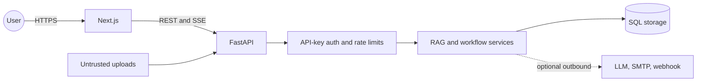

# Security

## Combined procedure evidence — 2026-10-25

The [current engineering record](combined-procedure-verification.md) verifies
publication/history checks against actual requests, rendered answers, immutable
source versions and independently retained execution context. Invalid saved
procedure evidence withholds answer/source content; revoked access retains its
separate restricted-access behavior. Historical verification does not rerun NLI
or silently reinterpret records under a new source-reading policy.

Modern malformed QA diagnostics cannot use legacy span-only compatibility. The
recorded profile and retained capture govern that decision. Missing configured
support assets fail new execution explicitly while saved valid evidence remains
inspectable. These checks are source-integrity controls; recorded classifier
decisions and file hashes are not cryptographic runtime attestations or human
validation. The answer-quality gate remains open.

The2026-10-26 opt-in context-v2 policy implements the owner's approved stated-note
interpretation. It assigns discourse references through exact typed structure
before inference and retains22 mandatory NLI obligations; it does not turn a neutral
model result into entailment. Authorization, relevant curated opposition, exact
source/version/range binding and actual output/history checks remain mandatory.
Context exclusions retain the inspected opposing-source identities for subsequent
history reauthorization. Library defaults and historical contract meanings remain
unchanged. A local policy interpretation is disclosed as such; it is not universal
contradiction detection or human validation.

The offline acceptance harness restricts requests to the configured frontend
origin, rejects backend API paths, write requests and WebSockets, and redacts
violation details. Its Page observers are test instrumentation, not a host-wide
network firewall. No hosted multi-user security certification is claimed.

## Current local application boundary — 2026-10-24

The connected profile binds to loopback and uses the existing hashed API-key
identity. Workspace, organization and group membership come from trusted key
metadata, never arbitrary request headers or document bodies. Key creation
inherits the administrator's workspace; inspection, changes and deactivation
remain scoped. This is verified local authorization behavior, not a hosted
identity or multi-user authentication certification.

New uploads are owner-private. Collection grants narrow reads/writes explicitly;
public/organization reads do not imply write access. Document/query/conversation/
version/source readers apply server-owned SQL predicates. Requested filters can
only narrow this scope. Unknown historical ownership stays administrator
restricted. Saved answers, citations and bounded memory recheck current source
access so revoked content cannot reappear through history.

Private keys are entered through a password field and retained only in tab
session storage. They do not enter URLs, bundles or public evidence. Browser
source/identity switching aborts old requests and clears private state. Request
logging uses an immutable safe identity snapshot rather than a detached ORM
object after session rollback; denial responses retain their intended status.
Raw credentials and document bodies are not logging fields.

Uploads are bounded to five files and 10 MiB each, with generated names and
containment checks. Parser/model failures produce safe durable job reasons;
replacement failure cannot remove the published version. Retries use new fenced
attempts; a late old worker must not publish or fail its replacement. API startup
preserves queued/healthy work and reconciles expired leases. No arbitrary
browser-supplied code, model path or tool execution is exposed.

Pinned embedding and extractive-reader downloads are separate and explicit;
runtime uses verified local safetensors
and tokenizer assets with remote code disabled. Missing/mismatched assets fail
instead of substituting a different model or successful lexical answer. Reader
dependencies are optional and the configured cache is server-owned; a browser
cannot select a model path. Raw model scores are not calibrated probabilities.
Only cataloged immutable revisions are accepted. Runtime rejects unverified extra
root files, preventing an unmanifested preferred tokenizer from overriding the
verified assets. Explicit reader comparison/setup and its failed development
results are in the [continuation record](answer-coverage-development-v3.md).
Selected spans are copied from authorized immutable source text and retain exact
offsets; read-time access checks cover their persisted provenance as well as
citations. A reader failure is distinct from an unsupported-question refusal.
Instructions embedded in retrieved text do not grant access. Curated conflict
groups, lexical support and extractive-reader decisions are bounded checks, not comprehensive prompt-injection,
contradiction, PII or semantic-entailment detection.

The optional selected-clause attribute signal ranks only already accepted
witnesses; it neither authorizes evidence nor proves factual support. Mixed or
unknown historical/custom diagnostic contracts retain ordinary ranking behavior.
Topic/exclusion checks and curated conflict inspection remain separate from this
signal. The [reviewed source checkpoint](evidence/answer-coverage-v7/README.md)
retains failing counterexamples and the limits of its literal parsing rules.

PostgreSQL/Redis process behavior, hosted CI, public hosting, provider use and
hosted multi-user authentication remain outside observed acceptance. The
[verification record](portfolio-verification.md) documents exact limits and
dependency findings. Keep original golden evidence and the first held-out result
separate from later repairs and sample-data demonstrations.

## Trust boundaries

Queries, headers, API keys, filenames, document contents, provider responses, and
notification payloads cross trust boundaries. GroundTruth uses validation, bounded
inputs, context-only prompting, refusal/citation gates, redaction, and opt-in outbound
adapters; it is not a substitute for deployment-layer HTTPS, network policy, backups,
or a secrets manager.

## Implemented controls

- API-key authentication is configurable. Raw keys are not retained for rate-limit
  identity and plaintext key material is returned only on creation.
- Fixed-window rate-limit buckets are isolated by `X-Workspace-ID` plus authenticated
  API-key ID, hashed `X-API-Key`, or client IP fallback. Responses include standard
  limit/remaining/reset headers and 429 `Retry-After`.
- Request/workspace context flows into structured logs, metrics, cost attribution,
  access predicates, and redacted audit events.
- Uploaded filenames are never trusted for path construction; storage names derive
  from document UUIDs plus validated extensions and real-path containment checks.
- Refusal and citation checks reduce ungrounded-answer risk. Retrieved document text
  is context, not executable instruction.
- Notification outbox metadata is redacted. In-memory/log sinks are the default;
  SMTP/webhook delivery is constructed only when explicitly configured.
- Document versions are immutable snapshots; restore creates a new version.

## Limitations

- Rate-limit buckets are process-local and fixed-window. Multiple API replicas need a
  shared limiter before this can be treated as a global quota.
- Workspace scoping is enforced in application queries and context. Database row-level
  security and a hosted tenant control plane are not claimed.
- Prompt-injection screening and citations reduce risk but do not prove that model
  output is safe or complete.
- The local webhook adapter is a basic outbound JSON client; production deployments
  should add destination allowlists, signing, retry policy, and network egress rules.
- The Compose files are examples, not hardened hosted infrastructure.

## Secrets

No credential is required for the offline demo or default unit/CI gates. For optional
integrations, provide secrets through the deployment environment and never commit
`.env`:

- `OPENAI_API_KEY` for provider-backed generation/embeddings.
- database credentials for PostgreSQL deployments.
- SMTP/webhook settings when those sinks are intentionally enabled.

Use a deployment-appropriate secrets manager, rotate credentials after exposure, and
keep production access logs free of raw keys or sensitive document content.

## Deferred security/identity surface

SAML/SSO, hosted/team administration, hosted notifications, mandatory infrastructure,
cloud object storage, and hosted scheduling are deliberately deferred. Do not infer
those controls from workspace-aware application code.

## Reporting

Use the repository's private security-reporting channel. This document intentionally
does not publish an unverified placeholder email address.

## Revoked diagnostic evidence

Saved reader traces may include candidates that produced no answer or citation.
Presentation reauthorizes those documents too, using the immutable saved
chunk-to-document mapping. Missing or malformed mappings fail closed. If any
retained candidate is now inaccessible, the complete answer/source/diagnostic
presentation is withheld, including in conversation memory and SSE. This is
deliberately conservative for an otherwise still-authorized selected passage.
Raw history is retained; current chunk rows cannot replace historical identity.

## Answer support remains a separate failed gate

The [latest frozen trial](evidence/answer-coverage-v8/README.md) passes recorded
byte/span/access checks while failing answer completeness and refusal contracts.
Authorization and quote integrity do not certify factual support. The later
[scope-directive repair](evidence/answer-coverage-v9/README.md) preserves original
questions, document-title constraints and SQL scope. It fixes no permission gate
and does not establish a new quality score or comprehensive injection protection.
Known disposable seed keys are excluded from published evidence; exact known-key
scans are bounded checks, not universal secret detection.
